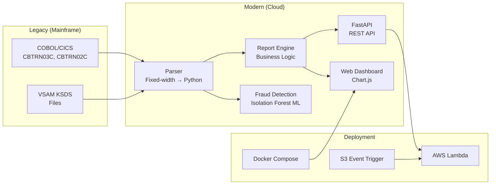

# 🏦 CardDemo Modernization: COBOL → Python / AWS Lambda

[](https://github.com/YankiOzarslan/aws-mainframe-modernization-carddemo/actions)
[](https://python.org)
[](LICENSE)
[](tests/)
[](SECURITY.md)

A **production-quality modernization** of AWS CardDemo — a mainframe COBOL credit card
management application — rewritten in Python, deployable to AWS Lambda, with a REST API,
ML fraud detection, and interactive web dashboard.

> **Why this matters:** Mainframe modernization is a $multi-billion industry. This project
> demonstrates the ability to read legacy COBOL, understand VSAM data layouts, and
> re-express business logic in cloud-native Python — a rare and valuable skill.

---

## 🏗️ Architecture (Golden Structure)



```
.
├── legacy_cobol/          # Original COBOL source + sample data
│   ├── CBTRN03C.cbl       # COBOL transaction report program
│   └── sample_input.dat   # Fixed-width sample data
├── modern_python/         # Modernized Python package
│   ├── models.py          # Data models (mirror COBOL copybooks)
│   ├── parser.py          # Fixed-width → Python (zoned decimal decode)
│   └── report_engine.py   # CBTRN03C business logic in Python
├── serverless/            # AWS Lambda deployment
│   ├── lambda_function.py # S3-triggered report generation
│   └── template.yaml      # AWS SAM template
├── api/                   # FastAPI REST API
│   └── main.py            # /report, /analytics, /transactions, /health
├── tests/                 # Parity & unit tests
│   └── test_parity.py     # COBOL ↔ Python output comparison
├── modernization/         # Extended modules (posting, fraud, web, CLI)
├── SECURITY.md            # Threat model + responsible disclosure
└── README.md
```

---

## ⚡ Quick Start

### CLI
```bash
cd modernization/transaction-report-service
PYTHONPATH=src python -m carddemo_report.cli --data-dir data/sample --dateparm data/sample/dateparm.txt
```

### Web Dashboard
```bash
PYTHONPATH=src CARDDATA_DIR=data/sample python -m carddemo_report.web
# → http://localhost:8000 (Chart.js dashboard, dark theme)
```

### REST API
```bash
pip install fastapi uvicorn
PYTHONPATH=modern_python uvicorn api.main:app --reload
# → http://localhost:8000/docs (Swagger UI)
```

### Docker
```bash
cd modernization/transaction-report-service
docker-compose up --build
# → http://localhost:8000
```

### AWS Lambda
```bash
cd serverless
sam build && sam deploy --guided
```

---

## 📊 Features

### 1. Transaction Report (CBTRN03C)
- Fixed-width VSAM file parsing (350-byte records)
- Zoned decimal (overpunch) amount decoding
- Date range filtering, card grouping
- Page/account/grand totals (page size 20)
- Formatted 133-column report output

### 2. Transaction Posting (CBTRN02C)
- Card cross-reference validation
- Account credit-limit & expiration-date checks
- Post valid transactions, write rejects with reason codes
- 277 posted / 23 rejected (7.7% reject rate on sample data)

### 3. Fraud Detection (ML)
- Isolation Forest (scikit-learn) unsupervised anomaly detection
- Risk scoring (0-1), reason codes, risk distribution
- 15 anomalies detected (5% contamination) on 300 transactions

### 4. Analytics
- Category totals, top merchants, daily volume
- JSON API endpoint

### 5. Security
- Bandit static analysis (0 issues)
- pip-audit dependency scanning
- SECURITY.md with threat model
- No secrets in code, input validation, Decimal precision

---

## 🧪 Testing

```bash
# Parity tests (COBOL ↔ Python)
PYTHONPATH=modern_python python -m pytest tests/ -q

# Full test suite (13 tests)
cd modernization/transaction-report-service
PYTHONPATH=src python -m pytest tests/ -q

# Property-based tests (hypothesis)
PYTHONPATH=src python -m pytest tests/ -q -k "parity or hypothesis"
```

### Test Types
- **Unit tests**: Report, posting, analytics, fraud, parsers
- **Parity tests**: COBOL output invariants (totals, grouping, page size, date filter)
- **Property-based tests**: Hypothesis (random data → invariant checking)

---

## 📈 Performance

| Metric | Value |
|--------|-------|
| Report generation (300 txn) | 0.66 ms |
| Throughput | 452,166 txn/sec |
| Reports/sec | 1,507 |
| Memory | < 50 MB |

---

## 🔍 Code Comparison: COBOL vs Python

**COBOL (original CBTRN03C):**
```cobol
READ TRANSACT-FILE INTO TRAN-RECORD
IF TRAN-PROC-TS (1:10) >= WS-START-DATE
   AND TRAN-PROC-TS (1:10) <= WS-END-DATE
   CONTINUE
ELSE
   NEXT SENTENCE
END-IF
```

**Python (modernized):**
```python
filtered = [t for t in transactions
            if start_date <= t.proc_date <= end_date]
```

**COBOL (zoned decimal):**
```cobol
05  TRAN-AMT  PIC S9(09)V99.
```

**Python (Decimal with overpunch decode):**
```python
tran_amt = _decode_zoned_amount(amt_str)  # Decimal, exact
```

---

## 📋 COBOL → Python Mapping

| COBOL (CBTRN03C) | Python (`modern_python/`) |
|---|---|
| `CVTRA05Y` (TRAN-RECORD) | `models.Transaction` + `parser.parse_transactions` |
| `CVACT03Y` (CARD-XREF) | `models.CardXref` + `parser.parse_cardxref` |
| `CVTRA03Y` (TRAN-TYPE) | `models.TranType` + `parser.parse_trantype` |
| `CVTRA04Y` (TRAN-CAT) | `models.TranCat` + `parser.parse_trancatg` |
| `CVACT01Y` (ACCOUNT) | `models.Account` + `parser.parse_accounts` |
| `CVTRA01Y` (TCATBAL) | `models.TranCatBal` + `parser.parse_tcatbal` |
| S9(09)V99 zoned decimal | `_decode_zoned_amount` (overpunch) |
| `SORT FIELDS=(TRAN-CARD-NUM,A)` | `sorted(transactions, key=card_num)` |
| Date filter on TRAN-PROC-TS | `Transaction.proc_date` (with ORIG-TS fallback) |
| Page size 20 + totals | `ReportEngine` page/account/grand totals |
| VSAM KSDS random reads | Python `dict` lookups (O(1)) |
| TDQ job submission (CICS) | S3 upload / API response |

---

## 🔒 Security

See [SECURITY.md](SECURITY.md) for threat model and responsible disclosure.

- Bandit static analysis: **0 issues**
- pip-audit dependency scanning
- No secrets in code (environment variables only)
- Input validation (datetime parsing)
- Decimal precision (no float drift)
- Least-privilege Lambda IAM

---

## 📜 License

Apache 2.0 (inherited from AWS CardDemo).

## 🙏 Acknowledgments

- [AWS CardDemo](https://github.com/aws-samples/aws-mainframe-modernization-carddemo) — original COBOL application
- AWS Mainframe Modernization team for open-sourcing CardDemo
