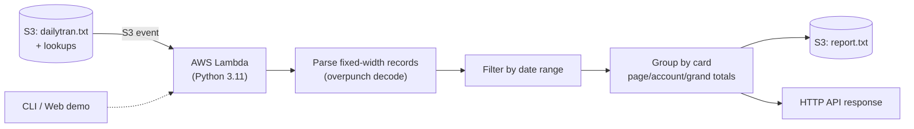

# CardDemo Transaction Report — Modernized (Python / AWS Lambda)


A modernization of the AWS CardDemo mainframe transaction report. The
original is the COBOL/CICS program **`CBTRN03C`** (with `TRANREPT` JCL/PROC),
which reads a VSAM transaction file, filters by a date range, performs
VSAM lookups (card cross-reference, transaction type, transaction category)
and writes a formatted report with page/account/grand totals.

This project reimplements that business logic in **Python** so it can run as
an **AWS Lambda** function (or locally via a CLI), while keeping the original
COBOL in the parent repository for traceability.

## Why this exists

Mainframe modernization case studies are a strong signal for employers:
they show you can read legacy COBOL, understand the data layout, and
re-express the logic in a cloud-native stack. This repo is intentionally
small and self-contained so the mapping is easy to review.

## Architecture



```
┌────────────────────┐        ┌─────────────────────────────┐
│  S3 (dailytran.txt │──────►│ Lambda: transaction report   │
│  + lookups)        │        │  - parse fixed-width records │
└────────────────────┘        │  - filter by date range     │
                              │  - group by card, totals    │
                              │  - write formatted report   │
                              └──────────────┬──────────────┘
                                             │
                                             ▼
                                    S3 (report.txt) / API
```

## COBOL → Python mapping

| COBOL (CBTRN03C) | Python (`carddemo_report`) |
|---|---|
| `CVTRA05Y` (TRAN-RECORD, RECLN 350) | `models.Transaction` + `parsers.parse_transactions` |
| `CVACT03Y` (CARD-XREF-RECORD) | `models.CardXref` + `parsers.parse_cardxref` |
| `CVTRA03Y` (TRAN-TYPE-RECORD) | `models.TranType` + `parsers.parse_trantype` |
| `CVTRA04Y` (TRAN-CAT-RECORD) | `models.TranCat` + `parsers.parse_trancatg` |
| `CVTRA07Y` (report layouts) | `report.py` header/detail/total formatters |
| S9(09)V99 zoned decimal (overpunch) | `_decode_zoned_amount` |
| `SORT FIELDS=(TRAN-CARD-NUM,A)` | `sorted(transactions, key=card_num)` |
| date filter on `TRAN-PROC-TS(1:10)` | `Transaction.proc_date` (with ORIG-TS fallback) |
| page size 20 + page/account/grand totals | `ReportTotals` + `_write_*_totals` |
| VSAM KSDS random reads | dict lookups (`xref`, `trantypes`, `trancats`) |
| TDQ `JOBS` submission (CICS) | S3 upload / API response (modern equivalent) |

## Run locally

```bash
cd modernization/transaction-report-service
PYTHONPATH=src python -m carddemo_report.cli \
  --data-dir ../../app/data/ASCII \
  --start 2022-06-01 --end 2022-06-30 \
  -o /tmp/report.txt
```

Or with the bundled sample data:

```bash
PYTHONPATH=src python -m carddemo_report.cli \
  --data-dir data/sample --dateparm data/sample/dateparm.txt
```

## Run tests

```bash
PYTHONPATH=src python -m pytest -q
```

## Web demo (optional)

```bash
pip install -r requirements-web.txt
PYTHONPATH=src CARDDATA_DIR=data/sample python -m carddemo_report.web
# open http://localhost:8000
```

## Run with Docker Compose

```bash
docker-compose up --build
# open http://localhost:8000
```

## Deploy to AWS Lambda

```bash
sam build
sam deploy --guided
```

Or build the container image:

```bash
docker build -t carddemo-report .
docker run --rm -e CARDDATA_DIR=/data carddemo-report
```

## Direct invocation payload

```json
{
  "start_date": "2022-06-01",
  "end_date": "2022-06-30",
  "data_dir": "s3://your-bucket/carddemo",
  "output_key": "reports/transaction-report.txt"
}
```

## Second module: Transaction Posting (CBTRN02C)

Modernized the posting program that validates and posts daily transactions:
- Card cross-reference lookup
- Account credit-limit and expiration-date validation
- Posts valid transactions, writes rejects with reason codes

```bash
PYTHONPATH=src python -m carddemo_report.cli --data-dir ../../app/data/ASCII --post
# → {"total": 300, "posted": 277, "rejected": 23, "reject_rate": "7.7%"}
```

## Third module: Fraud Detection (ML)

Unsupervised anomaly detection using Isolation Forest (scikit-learn):

```bash
PYTHONPATH=src python -m carddemo_report.cli --data-dir ../../app/data/ASCII --fraud
# → {"total_transactions": 300, "anomalies_detected": 15, "anomaly_rate": 0.05, ...}
```

Features: risk scoring (0-1), reason codes, risk distribution, high/medium risk lists.

## Bonus: Transaction Analytics

Beyond the faithful report, the `analytics` module computes the aggregates a
modern dashboard would expose: totals by category/type, top merchants, and
daily volume (JSON via `/analytics` or `--analytics`).

## Performance

Benchmark on a laptop (300 transactions, 100 runs):

```
Transactions: 300
Avg per run: 0.66 ms (1507 reports/sec)
Throughput: 452,166 txn/sec
```

No JCL, no job scheduler, no CICS region required.

## Code comparison: COBOL vs Python

**COBOL (original CBTRN03C):**
```cobol
READ TRANSACT-FILE INTO TRAN-RECORD
IF TRAN-PROC-TS (1:10) >= WS-START-DATE
   AND TRAN-PROC-TS (1:10) <= WS-END-DATE
   CONTINUE
ELSE
   NEXT SENTENCE
END-IF
```

**Python (modernized):**
```python
filtered = [t for t in transactions
            if start_date <= t.proc_date <= end_date]
```

**COBOL (zoned decimal amount):**
```cobol
05  TRAN-AMT  PIC S9(09)V99.
```

**Python (Decimal with overpunch decode):**
```python
tran_amt = _decode_zoned_amount(amt_str)  # Decimal, exact
```

## Notes on fidelity

- The original filters on `TRAN-PROC-TS`. Some CardDemo seed exports only
  populate `TRAN-ORIG-TS`; this implementation falls back to `ORIG-TS` so the
  report is still useful on seed data. This is documented as a deliberate
  modernization choice.
- The original's EOF branch re-adds the last record amount (a minor quirk).
  This implementation counts each transaction exactly once.
- Money is handled with `Decimal` to avoid float drift (COBOL S9(09)V99).

## License

Apache 2.0 (inherited from AWS CardDemo).
